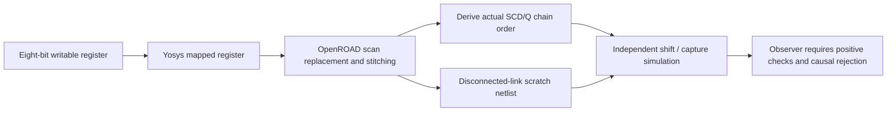

# Eight-bit SKY130 scan insertion

Yosys maps an eight-bit writable register; OpenROAD replaces its flip-flops with scan cells and stitches one chain. The measured baseline passed 514 checks and the inserted netlist passed 3,330 checks across all 256 byte values. A disconnected internal scan link failed the same observer with a nonzero exit. The serial tail reuses `q[0]`; the measured head-to-tail bit order is 1, 2, 3, 5, 7, 6, 4, 0.

- [Quick start](#quick-start)
- [How it works](#how-it-works)
- [What runs](#what-runs)
- [Repository layout](#repository-layout)
- [Individual stages](#individual-stages)
- [Results and controls](#results-and-controls)
- [Troubleshooting](#troubleshooting)
- [Reports and limits](#reports-and-limits)
- [Licence](#licence)

The implementation and whitepaper were locally verified on 27 October 2026. **Crucible is beta.** These are bounded engineering demonstrations, with the exclusions below.

## Included files

`rtl/register.v` defines the functional register. `scripts/insert.tcl` performs actual OpenROAD insertion. `chain.py` derives the serial order from saved SCD/Q connectivity. `tests/tb.v` exercises baseline and scan/capture behavior. `verify.py` checks the positive and disconnected-link artifacts.

The reviewed [PDF](docs/DFT_Eight_Bit_Scan_Insertion_Ignytion_A4.pdf) and [editable A4 PowerPoint](docs/DFT_Eight_Bit_Scan_Insertion_Ignytion_A4.pptx) are included. [Compact evidence](evidence/summary.json) records measured outcomes; [document hashes](evidence/documents.sha256.json) bind the final copies. Generated build artifacts and raw logs remain local and are excluded from Git.

## Quick start

Open a Linux/WSL terminal in this repository root. Crucible is beta. A complete, matching SKY130A high-density digital PDK is required: technology/cell LEF, TT 25 C/1.8 V Liberty, functional cell Verilog and primitives. The default PDK root is $HOME/.ciel/sky130A; a Make PDKPATH value overrides it. No extra observer Python packages are required.

```sh
igny init
igny workspace sync
igny tool install make --version 4.4.1 --env dft-scan
igny run --env dft-scan make setup
igny run --env dft-scan make check
```

The runner selects unchanged used official functional-model modules after preprocessing the PDK aggregate. It does not edit the PDK or replace missing models with handwritten cell behaviour.

Run the complete experiment after satisfying those prerequisites:

```sh
igny run --env dft-scan make run PDKPATH=/path/to/sky130A
```

Every executable example in this guide goes through Igny. Make delegates to the supplied stage scripts and observers; failed stages stop the workflow. Make 4.4.1 is installed separately from the existing engineering-tool lock. The setup target only checks Python standard-library availability. The check target checks observer imports; it does not qualify a PDK or native-library installation.

## How it works

OpenROAD replaces eight flip-flops with scan cells and stitches one chain. Connectivity determines the actual serial order. The same independent bench checks all byte values in the functional baseline and inserted netlist, then must detect a disconnected internal scan link.



## What runs

| Component | Pinned version |
|---|---|
| iverilog | 14.0.0 |
| openroad | 26Q3-771-g7cfb2105c9 |
| yosys | 0.63.0 |

The lock restores those engineering tools; the setup target prepares only project-local observer dependencies where needed. Initial acquisition may require network access. Native Windows/macOS/ARM tool execution and independent clean-machine reproduction are not established by these results.

## Repository layout

```text
.
|-- Makefile             Managed workflow entry points
|-- crucible.toml        Workspace selection
|-- crucible.lock        Engineering-tool identities
|-- rtl/                 Functional register
|-- tests/               Independent baseline, scan and capture bench
|-- scripts/             Insertion, connectivity extraction, official model selection and observers
|-- docs/                Reviewed PDF and editable PowerPoint
|-- evidence/            Compact reviewed measurement snapshots
`-- build/               Generated local artifacts; ignored by Git
```

## Individual stages

Run these from the same prepared workspace. Stages use earlier outputs; execute them in the listed order when reproducing the flow manually. The run target performs the full ordered workflow.

| Managed command | Work performed |
|---|---|
| `igny run --env dft-scan make build` | Map the real register, insert scan, derive chain order and prepare a disconnected-link fixture |
| `igny run --env dft-scan make test` | Simulate the baseline, inserted chain and negative fixture |

Inspect or recheck existing results without rebuilding:

```sh
igny run --env dft-scan make smoke
igny run --env dft-scan make report
igny run --env dft-scan make help
```

The smoke target validates existing generated evidence. It is not a new experiment run. The report target prints local summaries and fails if required results are absent. The sed target normalises only public shell inputs to LF; run invokes it automatically.

## Results and controls

Require DFT_BASELINE_PASS patterns=256 checks=514, DFT_SCAN_CAPTURE_PASS patterns=256 checks=3330, and DFT_INSERTION_FUNCTIONAL_SCAN_AND_NEGATIVE_CONTROL_VERIFIED. The disconnected link must produce Q_MISMATCH pattern=1 with nonzero exit. The measured head-to-tail q-bit order is 1, 2, 3, 5, 7, 6, 4, 0; q[0] is the tail.

Expected negative failures are handled by the existing runners/observers. Missing tools, compilation failures, timeouts and missing artifacts do not count as successful controls. Changing sources or inputs requires rerunning the affected stages and their dependents. Raw logs and generated runtime/PDK payloads remain local.

## Troubleshooting

| Symptom | Check / next action |
|---|---|
| Wrong workspace or missing tool | Open the terminal in the root containing crucible.toml; use the explicit project environment in this guide and restore the lock. |
| Make is not bound | Repeat the managed Make installation in Quick start. |
| Observer dependency is absent or changed | Repeat the managed setup target; retain the pinned requirements. |
| Native library or PDK is missing | Supply the prerequisites described above. Lock restoration and observer setup do not provision them. |
| Evidence is missing or stale | Run the full workflow or the affected stages in order. Preserve the reported failure instead of editing expected values. |
| Negative control unexpectedly passes | Treat the guard as failed and inspect its artifacts. |

## Reports and limits

Read the [technical report](docs/DFT_Eight_Bit_Scan_Insertion_Ignytion_A4.pdf) or its [editable PowerPoint](docs/DFT_Eight_Bit_Scan_Insertion_Ignytion_A4.pptx). The documents record measured results and exclusions; source commands in this README are the current managed workflow.

One synchronous register, one clock and zero-delay official cell models. Insertion-stage DEF/OpenDB does not establish routing or timing closure. No ATPG coverage percentage, power-aware test, manufactured-device or signoff claim.

Review the source/document package locally with:

```sh
igny run --env dft-scan make preflight
```

This checks the public candidate and document hashes; it does not publish anything or rerun engineering verification.

## Licence

Dependencies retain their upstream licences and credit. This checkout has no project-wide licence grant; the owner must select the intended project licence before presenting it as an open-source release. No upstream endorsement is implied.

Source repository: [CRUCIBLE-WORKBENCH/DFT_Scan](https://github.com/CRUCIBLE-WORKBENCH/DFT_Scan).
